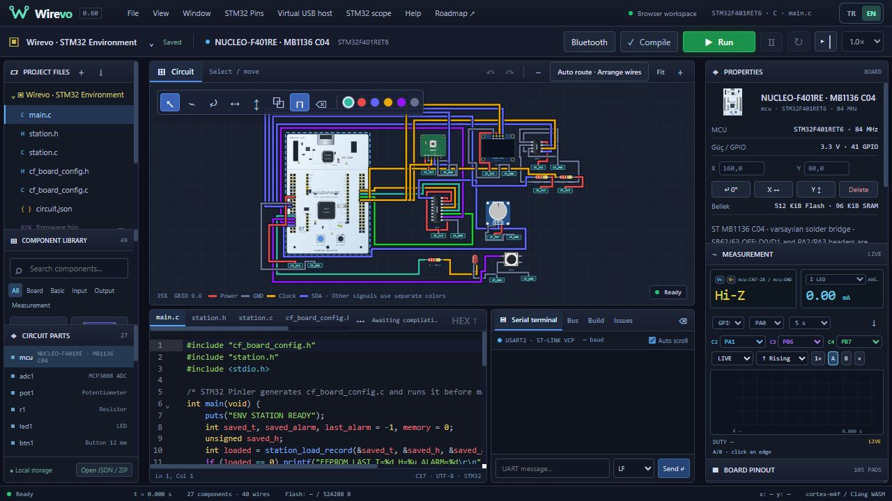
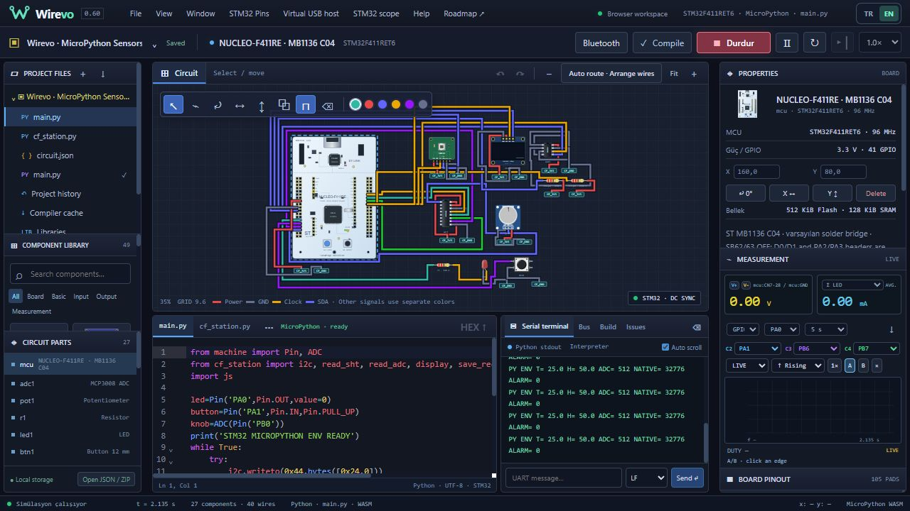
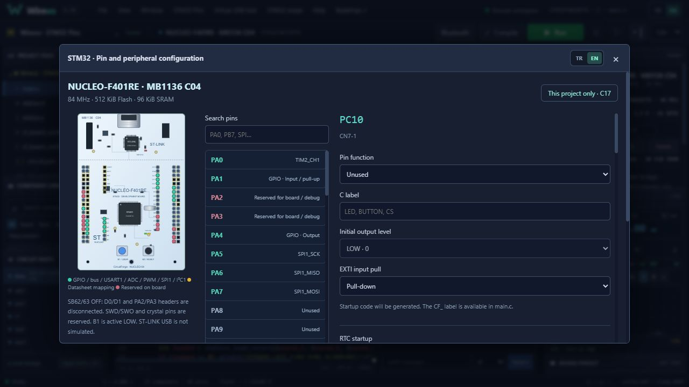
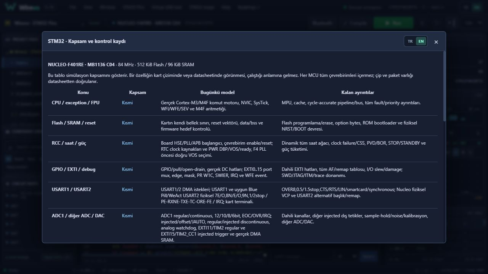

# Wirevo

Tarayıcıda elektronik devre tasarımı, firmware derleme ve simülasyon çalışma alanı. Kaynak sürümü: **0.60.0**.

**[Wirevo’yu tarayıcıda aç →](https://wirevo-furka.equalwood4.chatgpt.site/)**

AVR, ESP32 ve STM32 kartları; breadboard, kablolama ve net label; C17/C++17 ve desteklenen kartlarda MicroPython; sanal sensörler, seri haberleşme ve ölçüm araçları içerir. Kart ve çevrebirim kapsamı birebir tam silikon modeli değildir; ayrıntılar `dist/notices/` altındadır.

Amaç, fiziksel prototipe geçmeden desteklenen devreleri kurmak, kaynak kodunu çalıştırmak ve sinyal/çevrebirim davranışını incelemektir.

## Görseller

Uygulama yerelde çalıştırılarak alınan dört ekran görüntüsü.

### Çalışma alanı ve devre tasarımı



### Çalışan MicroPython devresi ve seri çıktı



### Projeye bağlı pin ayarları



### STM32 kapsam ve sınırları




## Başlangıç

Node.js 24 ve npm ile (GitHub kontrolleri de Node 24 kullanır):

```sh
npm ci
npm run build
npm start
```

Uygulamayı http://127.0.0.1:4173 adresinde açın. `dist/` yalnız yeniden üretilebilir çıktı değildir: çalışma zamanı, derleyici WASM dosyaları, görseller, örnekler ve lisans bildirimleri de içerdiği için depoda tutulur. İlk derleyici kurulumu ağ erişimi isteyebilir.

## Klasörler

| Klasör | İçerik |
| --- | --- |
| src/ | Editör, derleyici ve çalışma zamanı kaynakları |
| dist/ | Web uygulaması, modeller, WASM, lisanslar ve örnekler |
| scripts/ | Derleme, kabul ve sürüm araçları |
| tests/ | Otomatik regresyon testleri ve örnek girdiler |
| docs/ | Kapsam, kabul raporları ve geliştirme geçmişi |

## Kontroller

```sh
npm test
npm run build
npm run test:stm32
```

Bazı özel firmware kabul komutları ek araç zinciri veya ağ indirmesi gerektirir. Önce ilgili script ve kapsam belgesini okuyun.

## Sürümler

[Otomatik GitHub Release akışı](docs/SURUMLEME.md). Eski ayrıntılı sürüm notları [geliştirme geçmişinde](docs/GELISTIRME_GECMISI.md) korundu. Bu notlardaki `dist/`, `docs/`, `QA_*.md` yolları depo köküne göredir.

## Lisans ve kaynak

Üçüncü taraf lisanslar ve kaynak bildirimleri `dist/notices/` altındadır. Projenin tamamına yeni bir açık kaynak lisansı atanmadı.

İlk GitHub aktarımı, yerel CircuitForge kaynağının d50213fa684c26f72ab4a10e22643105e98e8bd1 commit'inden alınmış kaynak görüntüsüdür. Yerel araç ayarları, node_modules ve çalışma arşivleri dahil değildir.
