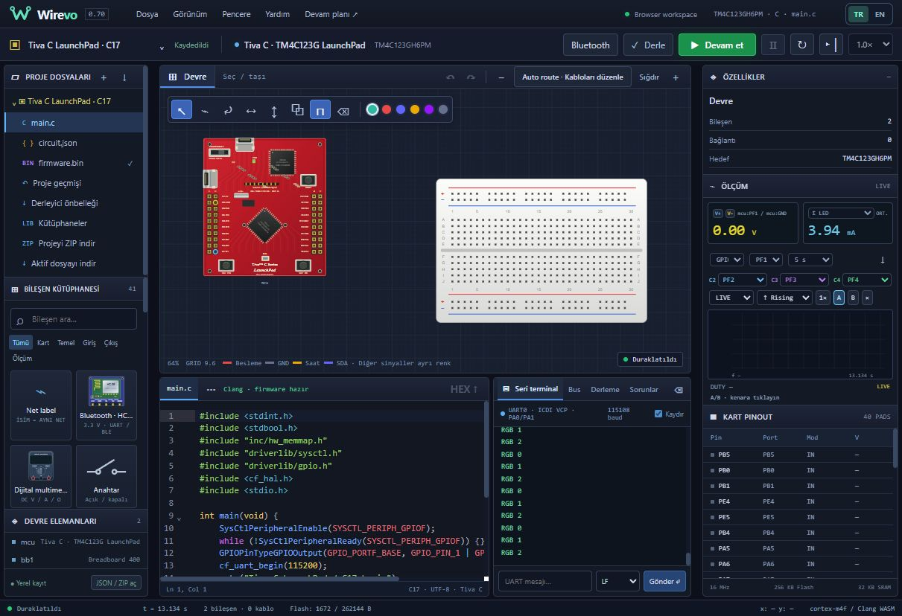

# Wirevo 0.70 — Tiva C TM4C123G LaunchPad / yalnız C17

Yeni proje → Mimari **Tiva C / TM4C123G** → LaunchPad → **C · main.c**. Arduino/C++/MicroPython seçenekleri yoktur. Gerçek Clang ARM firmware, ayrı Tiva bridge ve Flash0/SRAM32KiB; STM32 takma kartı değildir.

Robiz referanslı özgün kırmızı PCB SVG, TI şemasına göre40 header pad; RGB LED, SW1/SW2 ve gerçek kartın R9/R10 bağlantıları. Otomatik C SDK/driverlib başlıkları, çok dosyalı kaynaklar ve açık derleme hataları. GPIO, UART0 terminal, Timer A IRQ ve processor-trigger ADC hazır örnekleri.

Tam TI TivaWare, USB/ICDI, donanım SSI/I²C/DMA/CAN/motion-PWM ve tam silikon çevrim eşdeğerliği bu sürümde yoktur. [Kesin API ve model kapsamı](../dist/notices/TIVA-MODEL.md). STM32 kabul edilen işlevsel profili değiştirilmedi; eski STM32/genel testler yeniden çalıştırılmadı.

## Doğrulama

Yalnız yeni `npm run test:tiva`:12 kabul. Gerçek C derlemesi/Thumb yürütümü, RGB elektriksel akım/terminal, iki buton/PF0 unlock, Timer0A ve GPIOF native IRQ/WFI, PE3 ADC canlı değişim, 40/80 MHz nominal saat, UART RX/reset, masked GPIO/AHB, R9/R10, include çözümü/ayrılmış SDK dosyaları, dil/mimari/firmware korumaları, kaynak eşlemesi/ZIP ve browser-worker trace/reset. Native Tiva motoru release derlendi; browser build başarılı.

Tarayıcıda yeni proje yalnız C seçeneğiyle oluşturuldu; otomatik kütüphane paneli ve1672 bayt RGB örneği derlendi/çalıştırıldı. Terminal RGB0/1/2, kart LED akımı ve ayrı Tiva DC SYNC görünümü doğrulandı. Görünüm kontrolü computer-use ile yapıldı; eski kullanıcı projesi yeni proje akışının yerel geçmişinde korunur.

Referanslar: [Robiz kart fotoğrafı](https://robiz.net/ektm4c123gxl), [TI kart kılavuzu](https://www.ti.com/lit/ug/spmu296/spmu296.pdf), [TI MCU datasheet](https://www.ti.com/lit/ds/symlink/tm4c123gh6pm.pdf).
