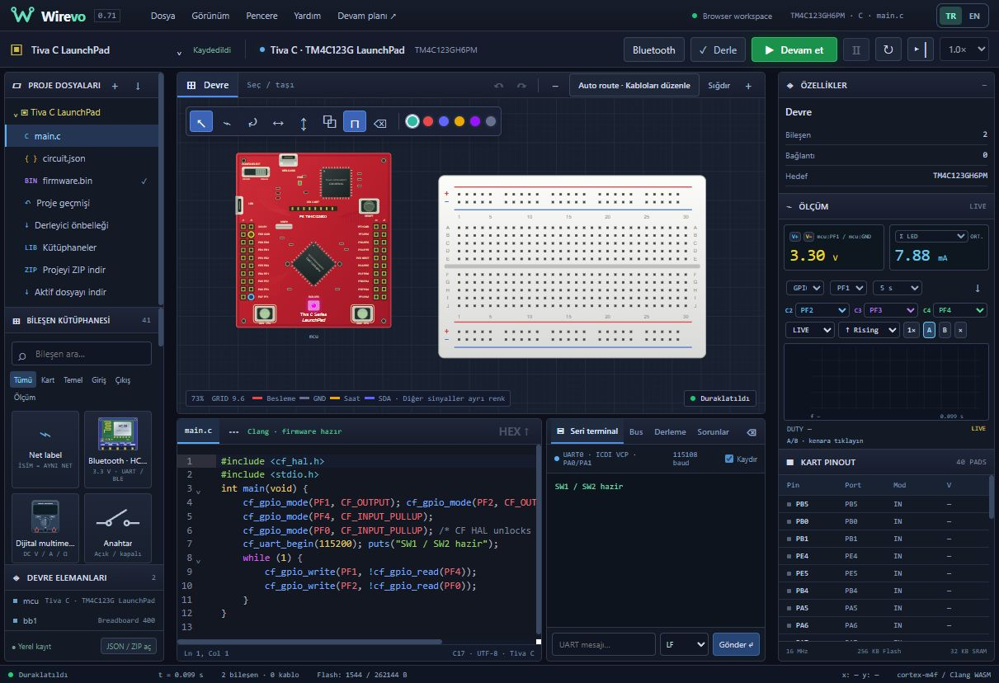

# Wirevo 0.71 — Tiva görünümü, kart üstü düğmeler ve dahili RGB

- Rastgele parça ve iz yerleşimi kaldırıldı. Çip pinleri, yazılar ve pasifler ayrı alanlarda; ICDI/target etiketleri ayrıldı, USB sadeleştirildi.40 pinin konumu ve R9/R10 elektriksel bağlantıları değişmedi. Devre alt açıklaması PCB üstünde karışan saydam yazı yerine okunaklı paneldir.
- Kart üzerindeki SW1/PF4 ve SW2/PF0 tıklanabilir ve Enter/Space ile erişilebilir. Bir tık basılı durumunu tutar, ikinci tık bırakır; özellik paneliyle aynı proje/elektriksel giriş durumunu kullanır. Kartı sürükleme/kablo/prob işlemiyle karışmaz.
- RESET kartın gerçek worker/MCU reset yolunu çağırır; firmware yüklenmemişse çalıştırma başlatmaz. POWER SELECT Debug/Device görsel besleme seçimini saklar. Modelde iki USB beslemesi de3.3V sağlar; sahte güç kesme veya USB/ICDI emülasyonu iddia edilmez.
- Dahili RGB üç küçük ayrı işaret yerine tek lens ve ışık halesidir. PF1 kırmızı, PF2 mavi, PF3 yeşil fiziksel direnç/LED akımlarından beslenir; renkler birleşebilir. GPIO biti yüksek ama geçerli akım sonucu yoksa LED yakılmaz. RGB’ye kablo veya haricî LED eklemek gerekmez; mevcut C GPIO kodu aynen çalışır.
- Ayrı `tiva-board-ui.js` katmanı kullanıldı. Native ARM/derleyici/çevrebirim davranışı değiştirilmedi.

Yeni kabul yalnız `npm run test:tiva-ui`:8 native C renk kombinasyonu, kart üstü SW durumuyla gerçek C cevabı/reset, geçersiz DC’de LED’in kapalı kalması, ölçek/pin/UI etiketleri ve canlı lens güncellemesi. Toplam12 yeni kabul.0.70 ve daha eski testler çalıştırılmaz. Görünüm/tıklama ayrıca yerel tarayıcıda kontrol edilir; bu, tüm silikon hatasızlığı garantisi değildir.

Örnek: `cf_gpio_mode(PF1, CF_OUTPUT); cf_gpio_write(PF1, 1);` kırmızıyı yakar. PF2 mavi, PF3 yeşildir. `Projeler → Tiva C · SW1 / SW2` örneği kart üzerindeki iki butonla kırmızı/mavi LED’i sürer; birlikte basılınca magenta görünür.

Tarayıcı kabulü: gerçek C örneğinde SW1 kırmızıyı, SW2 maviyi yaktı; birlikte magenta ve 7.88 mA görüldü. RESET çıkışları sıfırladı. POWER seçimi tıklama ve Enter ile değiştirildi. Yeni testlerde kapalı durum ve yedi renk birleşimi geçti; eski testler çalıştırılmadı.

