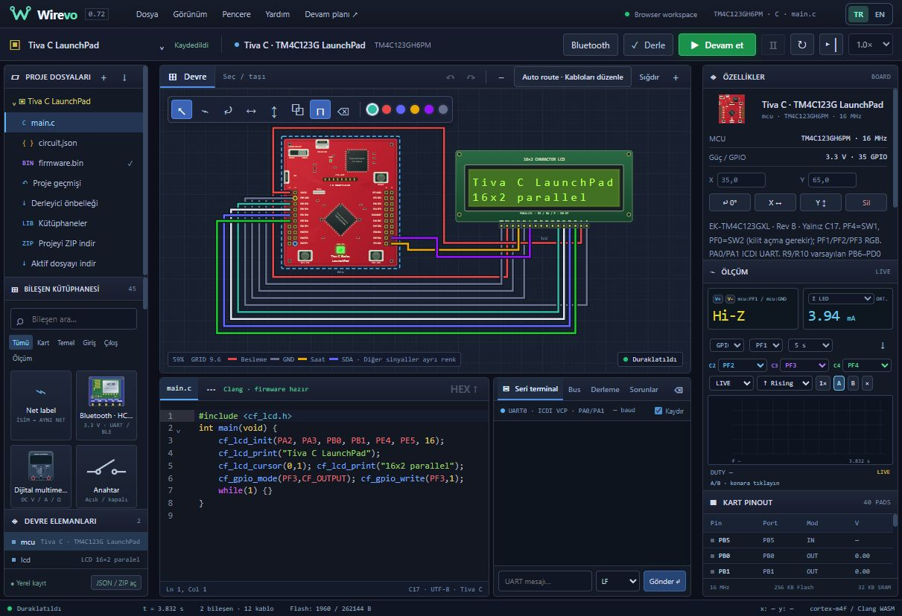
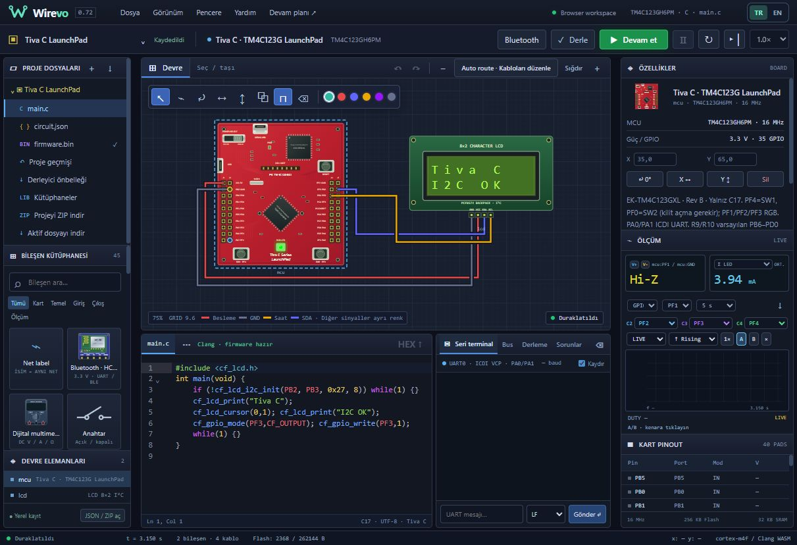

# Wirevo 0.72 — Tiva LCD ailesi ve canlı yayın

0.71'in temiz Tiva çizimi, tıklanabilir SW1/SW2/RESET ve gerçek akımdan çalışan RGB'sini içerir. Ek LCD'ler nedeniyle yeni kaynak sürümü 0.72.0'dır.

- Kütüphanede aynı yeşil PCB/metal çerçeve tarzında LCD 8×2 paralel, LCD 8×2 I²C ve LCD 16×2 paralel. Mevcut 16×2 I²C çizimi de aynı ailede tutulur.
- Modülsüz modeller standart 16 pinlidir: GND, VCC, VO, RS, RW, E, D0–D7, A, K. 4/8-bit yazma, busy/adres/veri okuma, DDRAM, CGRAM, clear/home ve display komutları; firmware kaynak metni yorumlanmaz. E kenarları gerçek devre gerilimlerinden alınır.
- Paralel modeller AVR devre motorunda ve native GPIO devre köprüsünde bulunur. TM4C123 için üç kablolu hazır örnek: `Tiva C · LCD 8×2 paralel`, `Tiva C · LCD 8×2 I²C`, `Tiva C · LCD 16×2 paralel`. Her biri iki satıra yazar ve tamamlandığında dahili yeşil RGB'yi yakar.
- C17 başlığı `#include <cf_lcd.h>` otomatik sağlanır. `cf_lcd_init(rs,e,d4,d5,d6,d7,columns)`, `cf_lcd_i2c_init(sda,scl,address,columns)`, `cf_lcd_cursor(col,row)`, `cf_lcd_print(text)`, `cf_lcd_clear()`; I²C helper ACK sonucunu döndürür. Bu özgün sınırlı helper, TI TivaWare/Arduino LiquidCrystal değildir. I²C yazılımsal GPIO'dur; yeni TM4C I²C donanım emülasyonu iddia edilmez.

## Bağlantı ve sınırlar

Hazır örnekler 3.3 V genel ST7066-uyumlu modül modelidir. Paralelde RW/VO/K=GND, A/VCC=3V3; RS=PA2, E=PA3, D4=PB0, D5=PB1, D6=PE4, D7=PE5. I²C SDA=PB2, SCL=PB3, adres=0x27; PCF8574 pull-up'ları modül beslemesinedir.

Model beslemesi 2.7–5.5 V'dur; her gerçek LCD'nin 3.3 V'da çalışacağı söylenmez. 5 V modülün veri okumaları/pull-up'ları doğrudan 3.3 V TM4C GPIO'ya bağlanmamalıdır; seviye dönüştürme gerekir. VO=0–1.5 V görünür kontrast aralığıdır; analog optik/termal LCD modeli değildir. A/K ayrı arka aydınlatmadır (genel 220 Ω sınırlı yük). ASCII ve mevcut CGRAM çizimi kullanılır, tam üretici CGROM/pixel geçiş süresi emülasyonu yoktur.

Referanslar: [ST7066 kontrolcü](https://newhavendisplay.com/content/app_notes/ST7066.pdf), [PCF8574](https://www.ti.com/lit/ds/symlink/pcf8574.pdf). Özgün SVG çizimleri CC0'dır.

Yalnız `npm run test:lcd-072` çalıştırılır; 0.71 ve daha eski testler yeniden çalıştırılmaz. Native C/GPIO ve iki satır içeriği, 4/8-bit komutlar/okuma, güç/kontrast/arka ışık, katalog/pinler/görünüm yeni kontrollerle doğrulanır.

