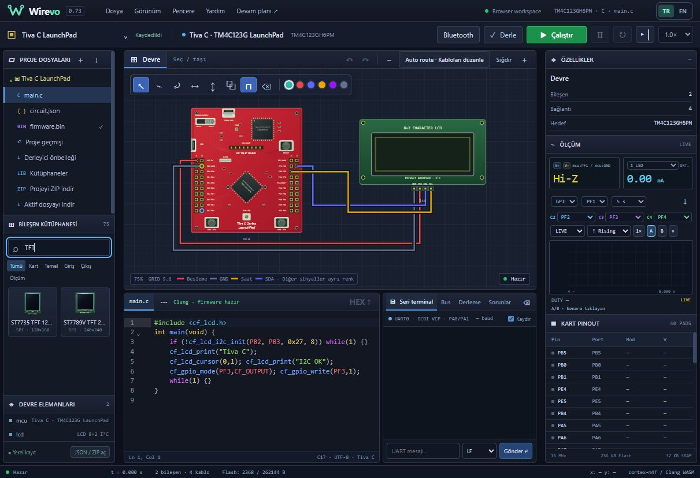

# Wirevo 0.73 — tüm kartlarda ortak bileşen kütüphanesi

Arduino/AVR, ESP32, STM32 ve TM4C123 artık aynı katalogdan 74 devre bileşeni sunar. Aynı isim, çizim, kategori, parametre ve pin tanımları kullanılır. MCU kart seçenekleri devrenin ailesine göre kalır; farklı MCU'lar tek devreye sessizce karıştırılmaz.

## Ortak simülasyon katmanı

Eski kısıtlı ESP_PARTS listesi kaldırıldı; arayüz ve ESP içe aktarma doğrulaması katalogdan türetilir. STM32/Tiva zaten ortak proje doğrulayıcısını kullanır. Bilinmeyen parçalar hâlâ reddedilir. Native devrelere parça eklemek, kaydetmek ve tekrar açmak aynı tanımı kullanır.

Sadece listede görünürlük açılmadı. `native-components.js`, AVR'nin mevcut elektriksel aygıt modellerini gerçek native GPIO netleri ve 16 MHz model zamanına bağlar:

- TFT ST7735/ST7789, MAX7219 matris/7-segment ve BMP280 GPIO-SPI;
- HC595/HC165, MCP23S17, MAX6675;
- DHT11/22, HX711, TM1637, KY040, keypad/loadcell;
- servo, HC-SR04, WS2812, ULN2003/28BYJ ve L298 DC katmanı;
- PIR zamanlaması, sinyal üreteci, MH-Z19 GPIO-UART.

Mevcut I²C, paralel LCD, 1-Wire, Bluetooth, analog/DC ve ölçüm katmanları kullanılır. Yeni köprü sahte AVR kayıtları/hardware SPI içermez; çözülen gerilimleri ve GPIO kenarlarını örnekler. SPI/UART burada yazılımsal GPIO yoludur. Kartın kendi hardware çevrebirim desteği değişmez.

TFT/segment/motor/dijital aygıt snapshot'ları canlı görsel ve özellik paneline aktarılır. Kablo/parametre değişiminde mevcut aygıt durumu korunur; kaldırılan aygıtın zamanlanmış olayları etkisizleştirilir. MCU zamanı sıfırlanırsa eski zaman kuyruğu taşınmaz. Boş projede ortak adaptörler kurulmaz; gereksiz ek DC çözümü yapılmaz.

ESP/STM Python GPIO köprüleri zamanlanmış cihaz olaylarına ilerler. Küsuratlı saat dönüşümünde aynı olayda takılma düzeltildi. MH-Z19 aygıt TX seviyesi 3.3 V'dur; MCU'nun kendi USART TX seviyesi değiştirilmedi. [Winsen MH-Z19B kılavuzu](https://www.winsen-sensor.com/d/files/manual/mh-z19b.pdf) besleme ile arayüz gerilimini ayrı belirtir.

## Kapsam ve bağlantı şartları

Aynı bileşen, her karta aynı firmware kaynak kodu veya Arduino C++ kütüphanesi anlamına gelmez. Tiva yalnız C17'dir; diğer kartların dil/API/pin/ADC/PWM olanakları kendi profillerine tabidir. Kütüphanede görünmek MCU'nun desteklemediği donanım kayıtlarını eklemez.

5 V modüllerin beslemesi/seviye dönüşümü ve direnç/pull-up gereksinimleri korunur. 3.3 V GPIO'yu 5 V'a bağlayınca hata gizlenmez. WS2812/MAX7219 için uygun lojik seviye gerekir. Yeni GPIO-UART testi MH-Z19'un 5 V beslemesini ve 3.3 V TX seviyesini ayrı doğrular.

AVR'nin cycle-transient RC/RL katmanı native motorlara taşınmadı: native modellerde kapasitör/indüktör önceki DC davranışındadır. Yeni analog/termal, tam fiziksel silikon veya tüm protokol varyantları eşdeğerliği iddia edilmez. Mevcut aygıt kapsam belgeleri geçerlidir.

## Yalnız yeni doğrulama

`npm run test:common-073`: 30 kart profilinde ortak 74 parçanın görünürlüğü; tüm native profillerde yerleştirme/kayıt doğrulaması; ESP32 ve STM32 elektriksel/Python GPIO köprülerinde gerçek TFT pikseli, HC595 latch, MAX7219 frame, servo darbesi, DHT, WS2812 ve MH-Z19 zamanlaması. TM4C123'te gerçek derlenmiş C17/native ARM, HC595'e saat verir; reset sonrası yeniden çalışır. Bu testler tüm parçaların her MCU'da fiziksel donanım testi değildir. Önceki test dosyaları çalıştırılmaz.

Toplam 21 yeni kontrol: çevrimdışı bağımlılık listesi ve değiştirilen SPI girişinin AVR donanım callback kurulumu/geri alma kontrolü de dahildir. Tarayıcıda TM4C123 projesinde 75 öğe (74 ortak bileşen + kendi kartı) ve iki TFT kartı görüldü.

